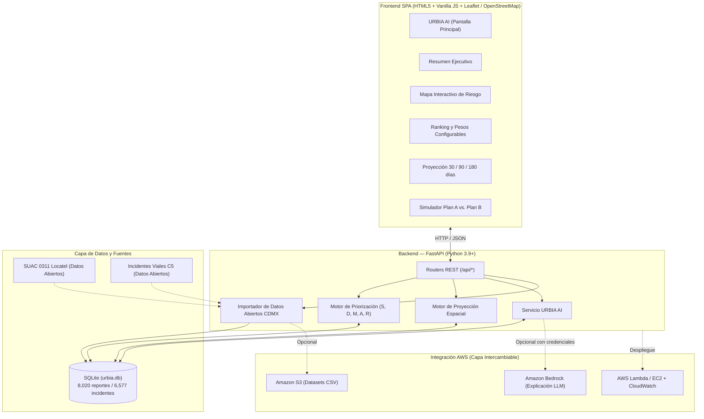

# URBIA CDMX — AWS Hackathon Kiro 2026

**Plataforma Inteligente de Priorización, Proyección y Gestión de Infraestructura Urbana para la Ciudad de México**

> ⚠️ **Aviso de responsabilidad:** Esta plataforma es una herramienta técnica de apoyo a la toma de decisiones desarrollada para el **AWS Hackathon Kiro 2026**. No sustituye los dictámenes de ingeniería civil, la verificación en campo ni las atribuciones legales de las dependencias de la Ciudad de México.

---

## Resumen del Proyecto

**URBIA CDMX** transforma reportes ciudadanos dispersos e incidentes viales en decisiones operativas trazables, explicables y auditables:

1. **Deduplicación Geoespacial y Temporal:** Agrupa reportes cercanos (`< 200 m` por distancia Haversine, misma categoría y ventana `< 30 días`) en incidentes únicos sin alterar los registros originales.
2. **Motor Determinista de Priorización ($S, D, M, A, R$):** Calcula un puntaje transparente de `0` a `100` con pesos configurables en tiempo real y escalamiento inmediato para emergencias confirmadas.
3. **Motor de Proyección de Afectaciones Futuras (30, 90 y 180 días):** Identifica celdas viales (`~250 m`) y colonias con riesgo histórico de baches, obstrucción de drenaje e inundaciones considerando historial, reincidencia, recencia, vecindad espacial y temporada de lluvias.
4. **Asistente Conversacional URBIA AI:** Responde consultas sobre vialidades críticas, distribución por alcaldía, presupuesto de intervención y marco normativo citando siempre fuente, fecha de corte y nivel de confianza (con arquitectura lista para **Amazon Bedrock**).
5. **Planeación Operativa y Presupuestal:** Compara estrategias de intervención (**Plan A: Máximo Riesgo** vs. **Plan B: Máxima Cobertura**) bajo restricciones presupuestales.
6. **Desarrollo Guiado por Especificaciones con Kiro (`.kiro/specs`):** Requisitos en formato EARS, diseño técnico y trazabilidad de tareas mantenidos en `.kiro/specs/`.

---

## Arquitectura



---

## Estructura del Repositorio

```text
.
├── .kiro/
│   └── specs/
│       ├── urbia-cdmx/               # Especificación base (requirements, design, tasks)
│       └── urbia-ai-asistente/       # Especificación del asistente y mejoras de datos
├── urbia-cdmx/
│   ├── backend/
│   │   ├── main.py                   # Aplicación FastAPI y ciclo de arranque
│   │   ├── models/schemas.py         # Esquemas Pydantic (Reporte, Incidente, PesosMotor)
│   │   ├── routers/
│   │   │   ├── api.py                # Endpoints principales (resumen, mapa, ranking, chat, CSV)
│   │   │   └── proyeccion.py         # Endpoints de proyección a 30, 90 y 180 días
│   │   ├── services/
│   │   │   ├── priorizacion.py       # Fórmula S-D-M-A-R y agrupación Haversine
│   │   │   ├── proyeccion.py         # Índice de riesgo futuro por celda (~250m) y colonia
│   │   │   ├── asistente.py          # URBIA AI determinista + interfaz para Bedrock
│   │   │   ├── alcaldias.py          # Catálogo, perímetros y geocodificación de 16 alcaldías
│   │   │   ├── importador.py         # Descarga y normalización de Locatel 0311 y C5
│   │   │   └── database.py           # Capa de persistencia SQLite
│   │   └── data/
│   │       ├── demo_data.py          # 20 reportes semilla y catálogo normativo/fuentes
│   │       └── urbia.db              # Base SQLite pre-cargada (8,000 registros históricos + 20 demo)
│   ├── frontend/
│   │   ├── index.html                # Dashboard SPA responsivo
│   │   └── static/js/app.js          # Lógica de interfaz, mapa Leaflet y gráficas
│   ├── scripts/
│   │   ├── run_import.py             # Ejecución de importación de fuentes abiertas
│   │   └── setup_and_import.py       # Inicialización completa de base de datos
│   ├── tests/
│   │   └── test_motor.py             # Suite de 10 pruebas automatizadas de aceptación
│   ├── .env.example                  # Plantilla de variables de entorno
│   ├── start.sh                      # Script de arranque rápido (Linux / macOS / Git Bash)
│   └── README.md                     # Documentación operativa del módulo
├── tasks.md                          # Seguimiento general de entregables del Hackathon
└── README.md                         # Este documento
```

---

## Inicio Rápido

### Requisitos previos
- **Python 3.9+**
- Dependencias de Python: `fastapi`, `uvicorn`, `pydantic`, `requests`, `python-multipart`

### Opción A — Windows (PowerShell)

```powershell
cd urbia-cdmx
python -m pip install fastapi uvicorn pydantic requests python-multipart
python -m uvicorn backend.main:app --host 0.0.0.0 --port 8000 --reload
```

### Opción B — Linux / macOS / Git Bash

```bash
cd urbia-cdmx
bash start.sh
```

Una vez iniciado el servidor, abre en tu navegador:
- **Dashboard Principal:** http://localhost:8000
- **Documentación Interactiva API (Swagger UI):** http://localhost:8000/docs

---

## Metodología del Motor de Priorización

El motor calcula el puntaje de cada incidente único mediante una combinación lineal transparente y determinista:

$$\text{PRIORIDAD} = 0.30(S) + 0.25(D) + 0.20(M) + 0.15(A) + 0.10(R)$$

| Variable | Nombre | Peso Base | Criterio de Cálculo (0–100) |
|:---:|---|:---:|---|
| **S** | Seguridad y gravedad | `30%` | Emergencia confirmada (`100`), vialidad bloqueada/inundación (`85`), hundimiento (`75`), bache/pavimento (`50`), coladera/drenaje (`45`). |
| **D** | Frecuencia de denuncias | `25%` | Escala logarítmica sobre reportes agrupados: $\min(100, \frac{\ln(n+1)}{\ln(51)} \times 100)$. Evita que el volumen bruto eclipse emergencias puntuales. |
| **M** | Impacto en movilidad | `20%` | Vialidad primaria (+40), subcategoría de alto impacto (+30), alcaldía de alta densidad (+10) sobre base 20. |
| **A** | Antigüedad del incidente | `15%` | Días transcurridos desde el primer reporte abierto normalizados a 365 días. |
| **R** | Riesgo ambiental / lluvia | `10%` | Alcaldía con peligrosidad histórica de inundación (+40), categoría hidráulica (+30), inundación/encharcamiento (+20). |

- **Regla de Emergencia:** Cualquier incidente con `es_emergencia = 1` o `estado = 'emergencia'` recibe automáticamente puntaje `100` y se posiciona al inicio del ranking sin importar la configuración de pesos.
- **Principio de No Alucinación:** El cálculo nunca se delega a un LLM; **URBIA AI** / **Amazon Bedrock** únicamente explica los puntajes ya calculados por el motor determinista.

---

## Endpoints Principales de la API

| Método | Ruta | Descripción |
|---|---|---|
| `GET` | `/api/resumen` | Métricas globales, conteos por categoría/alcaldía y aviso dinámico de origen de datos |
| `GET` | `/api/incidentes` | Ranking de incidentes únicos ordenados por prioridad (filtrable por alcaldía, categoría, nivel, estado) |
| `GET` | `/api/reportes` | Reportes individuales con filtros de fecha, alcaldía, categoría y emergencia |
| `GET` | `/api/mapa` | Incidentes georreferenciados con coordenadas confirmadas para renderizado en Leaflet |
| `POST` | `/api/recalcular` | Recalcula todos los incidentes con pesos personalizados ($S + D + M + A + R = 1.0$) |
| `POST` | `/api/chat` | Consulta en lenguaje natural al asistente **URBIA AI** |
| `GET` | `/api/proyeccion` | Zonas con índice de riesgo histórico a `30`, `90` o `180` días |
| `GET` | `/api/proyeccion/resumen` | Resumen ejecutivo de proyección, validación temporal (backtest) y limitaciones |
| `GET` | `/api/proyeccion/zona/{id}` | Historial detallado y evolución por horizonte para una celda o colonia |
| `POST` | `/api/upload-csv` | Ingesta manual de reportes desde archivo CSV |
| `POST` | `/api/importar-real` | Descarga e importación directa desde el Portal de Datos Abiertos de la CDMX |
| `GET` | `/api/fuentes` | Catálogo de fuentes de datos con licencia, URL y fecha de corte |
| `GET` | `/api/normativa` | Matriz de marco normativo referencial de la CDMX |

---

## Fuentes de Datos Integradas

La base de datos incluida (`urbia-cdmx/backend/data/urbia.db`) cuenta con **8,020 reportes** y **6,577 incidentes únicos** procesados:

| Fuente | Registros en BD | Cobertura | Origen |
|---|---:|---|---|
| **SUAC 0311 Locatel** (`archivo.datos.cdmx.gob.mx`) | `5,000` | Histórico 2023 | Datos Abiertos CDMX (`real`) |
| **Incidentes Viales C5** (`archivo.datos.cdmx.gob.mx`) | `3,000` | Histórico 2022–2024 | Datos Abiertos CDMX (`real`) |
| **Semilla de Demostración URBIA** | `20` | Escenarios de prueba | Simulación controlada (`demo`) |

---

## Pruebas Automatizadas

Ejecuta la suite de verificación de los 10 criterios de aceptación desde `urbia-cdmx/`:

```bash
cd urbia-cdmx
python tests/test_motor.py
```

Criterios validados automáticamente:
1. Deduplicación de reportes cercanos (`< 200 m`) en un único incidente.
2. Escalamiento estricto de emergencias confirmadas al primer lugar (`puntaje = 100`).
3. No invención de coordenadas cuando un reporte carece de latitud/longitud.
4. Determinismo matemático del motor ($f(x) = y$ idéntico en ejecuciones repetidas).
5. Sensibilidad del ranking ante cambios de pesos (ej. escenario de lluvias intensas).
6. Respeto del estado histórico (`cerrado`) sin reabrir incidentes concluidos.
7. Etiquetado explícito de costos y recursos de planeación como provisionales/ficticios.
8. Respuesta controlada (`sin datos`) del asistente cuando no existe evidencia en la base.
9. Trazabilidad completa de fuentes oficiales y marco normativo con URLs.
10. Operación autónoma local de extremo a extremo.

---

## Configuración de Variables de Entorno

Copia `urbia-cdmx/.env.example` a `urbia-cdmx/.env` si deseas personalizar puertos o conectar credenciales de **AWS**:

```ini
HOST=0.0.0.0
PORT=8000
ENV=development
DB_PATH=backend/data/urbia.db
LOAD_DEMO_DATA=true

# Opcional — Integración AWS (Amazon Bedrock / Amazon S3)
# AWS_ACCESS_KEY_ID=
# AWS_SECRET_ACCESS_KEY=
# AWS_REGION=us-east-1
# BEDROCK_MODEL_ID=anthropic.claude-3-sonnet-20240229-v1:0
# S3_BUCKET_NAME=urbia-cdmx-data
```
